# Cert_EET — Guide de style

> Charte d'interface de Cert_EET, établie par l'épopée **E10 « Expérience utilisateur & charte
> ESPRIT »** (US-UI-01 → US-UI-08, journaux 95 à 102). À lire avant d'ajouter ou de modifier un
> écran. Les valeurs vivent dans `apps/web/src/app/globals.css` (bloc `:root`) : ce guide les
> explique, il ne les remplace pas.

## 1. Principes

1. **En ouvrant une page, on sait quoi faire.** Un titre, une phrase qui dit à quoi sert la page,
   au plus **une action pleine** (rouge). Le reste est en contour.
2. **Le rouge ESPRIT est réservé** à la marque et à l'action principale. Il n'indique jamais un
   état : une erreur utilise un rouge plus sombre, une icône et un texte.
3. **Les mêmes mots partout.** Le libellé d'un menu est le titre de la page qu'il ouvre
   (« Mes formations », « Mes évaluations », « Mes certificats »…). Aucun code interne
   (« US-… », noms de tables, « jeton ») dans un texte visible.
4. **Toujours une suite.** Une liste vide, une erreur ou un lien périmé dit quoi faire ensuite.
5. **Lisible par tous.** Contrastes WCAG 2.1 AA, clavier complet, mobile à 390 px sans
   défilement horizontal.

## 2. Palette

| Jeton | Valeur | Usage | Contraste |
|---|---|---|---|
| `--primary` | `#e30613` | Rouge ESPRIT : logo, bouton plein, onglet actif, filet d'accent | blanc dessus : 4,88:1 |
| `--primary-dark` | `#b1040e` | Liens et texte rouge | 7,26:1 sur blanc |
| `--primary-soft` | `#fdecec` | Fond de sélection, pastille d'icône | rouge foncé dessus : 6,36:1 |
| `--ink` / `--text` | `#1d1d1b` | Titres, texte courant (noir ESPRIT) | 16,88:1 sur blanc |
| `--text-2` | `#3f3f46` | Libellés de champs | — |
| `--muted` | `#5f6368` | Texte secondaire, dates, aides | 6,05:1 sur blanc |
| `--placeholder` | `#6b7280` | Exemple dans un champ | 4,83:1 sur blanc |
| `--bg` | `#f7f7f8` | Fond de page (léger dégradé vers `--bg-bas` `#f2f2f4`) | — |
| `--surface` | `#ffffff` | Cartes, fenêtres, champs | — |
| `--border` | `#e4e4e7` | Filets décoratifs | — |
| bordure de champ | `#8a8a8f` | Contour des champs (survol `#6b6b70`) | 3,4:1 (critère 1.4.11) |
| `--succes` / `--succes-doux` | `#1e7a45` / `#e8f5ee` | Réussite, « Émis », « Actif » | 5,35:1 sur blanc |
| `--danger` / `--danger-soft` | `#9b1c1c` / `#fdecec` | Erreur, action destructrice | 8,15:1 sur blanc |
| `--info` / `--info-soft` | `#1d4f91` / `#e8f0fb` | Information, rôle « Formateur » | 7,09:1 sur son fond |
| `--accent` / `--accent-dark` | `#f59e0b` / `#8a5a00` | Ambre : décor ; texte ambre seulement en foncé | 5,40:1 sur sa pastille |

Règle : une nouvelle couleur passe d'abord par un jeton de `:root`, avec son contraste en
commentaire. Le PDF du certificat et le rapport de tentative reprennent le même rouge.

## 3. Typographie

Police système (`system-ui, -apple-system, 'Segoe UI', Roboto, sans-serif`) : rapide, lisible,
sans fichier à charger. Chiffres et empreintes en `ui-monospace` (classe `.mono`).

| Jeton | Taille | Usage |
|---|---|---|
| `--fs-h1` | 30 px, gras 700 | Titre de page (un seul `h1`) |
| `--fs-h2` | 21 px | Titre de section |
| `--fs-carte` | 17 px, 650 | Titre de carte |
| `--fs-kpi` | 34 px | Chiffre clé d'un tableau de bord |
| `--fs-corps` | 15 px | Texte courant, champs |
| `--fs-petit` | 13 px | Dates, aides, libellés de tableau |
| `--fs-etiquette` | 12 px | Pastilles, surtitres en capitales |

Espacements sur une échelle 4 / 8 / 12 / 16 / 24 / 32 px (`--sp-1` → `--sp-6`) ; rayons 16 px
(cartes), 10 px (champs, boutons), pilule (pastilles).

## 4. Coque et navigation

- **En-tête** : logo ESPRIT + « Cert_EET », recherche de formation, **cinq entrées au plus** par
  rôle, la première étant « Accueil », puis le menu du compte. Sous 640 px, menu « burger ».
  - Apprenant : Accueil · Mes formations · Mes évaluations · Mes certificats · Catalogue
  - Formateur : Accueil · Mes formations · Alertes · Rapports · Catalogue
  - Administrateur : Accueil · Utilisateurs · Formations · Certificats · Pilotage, avec une
    sous-navigation par section (`SOUS_NAVIGATION_ADMIN` dans `components/navigation.ts`)
  - Visiteur : « Se connecter » et « S'inscrire », sauf sur la page qui fait déjà cette action
- **Accueil du rôle** : « À faire maintenant » (`AFaireMaintenant`, règles dans `lib/a-faire.ts`)
  en tête — chaque ligne a un verbe et un bouton —, puis le contenu courant.
- **Fil d'Ariane** (`FilAriane`) : « Accueil › Section › … › Page ». Une page profonde ajoute ses
  miettes avec `useMiettes([...])` ; plus aucun lien « ← Retour ».

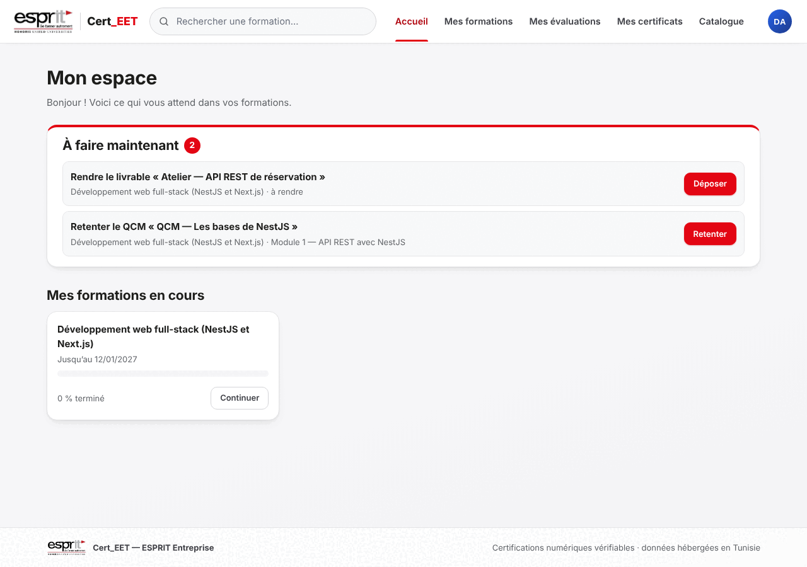

## 5. Composants

### En-tête de page — `EnTetePage`
`titre`, `phrase` (à quoi sert la page, une ou deux lignes), `statut` (pastille) et `actions`.
Une seule action pleine dans `actions` ; les autres en `btn-secondaire` / `btn-sm`.

### Boutons
| Classe | Rôle |
|---|---|
| `.btn` | Action pleine (rouge) — **une par écran ou par fenêtre** |
| `.btn.btn-secondaire`, `.btn-sm` | Action secondaire, en contour |
| `.btn-primary-sm` | Petite action pleine (par exemple « Nouvelle formation ») |
| `.btn-danger` | Action destructrice en contour rouge sombre ; `.btn-danger-solid` pour la confirmer |
| `.btn-lien` / `.btn-link` | Action discrète au fil du texte |
| `.btn-oauth` | Connexion Google ou GitHub, toujours en contour |

Le libellé est un verbe à l'infinitif qui dit le résultat : « Déposer », « Retenter »,
« Révoquer définitivement ». Pendant l'envoi : verbe au participe (« Réactivation… ») et bouton
désactivé.

### Champs
`.input` sur toute la largeur, libellé au-dessus (`.field-label`), aide en dessous en
`--fs-petit`. Focus : bordure rouge + anneau `--ring`. Erreur : message `.alert-error` près du
champ, jamais la couleur seule.

### Pastilles
`.statut-badge statut-<STATUT>` et `.role-badge role-<ROLE>` : texte court, toujours le libellé
français (« Émis », « En cours », « Formateur »), jamais la valeur brute de l'API.

### Messages
`.alert-success` (✓), `.alert-info` (ℹ), `.alert-error` (⚠ + filet gauche rouge sombre) : une
phrase, ce qui s'est passé et ce qu'on peut faire.

### État vide — `EtatVide`
`titre` (ce qui manque), `texte` (pourquoi, et quoi faire), `action` facultative. Modèle de
phrase : « Aucun certificat pour l'instant » / « Terminez une formation pour obtenir le premier. »

### Listes compactes — `.table-compacte`
Pour les listes longues (certificats, risque, comptes) : une ligne par élément, le nom en
`th scope="row"`, le détail dans une fenêtre. Sous 640 px, chaque ligne devient une carte ; les
cellules portent `data-libelle` pour garder leur intitulé.

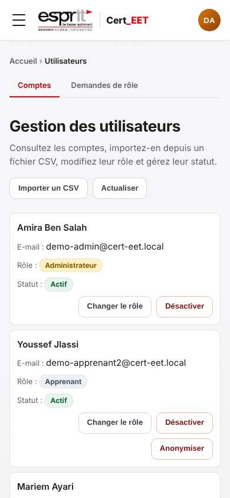

### Fenêtres — `Fenetre`
Une seule fenêtre accessible pour tout dialogue : `role="dialog"`, `aria-modal`, focus placé
dedans puis gardé, **croix, Échap et clic à l'extérieur** pour fermer, focus rendu à l'élément
d'origine, plein écran sous 640 px. `occupe` bloque la fermeture pendant un envoi ;
`taille="large"` pour une fiche détaillée. Les anciennes fenêtres (`.profil-overlay`) reçoivent
le même comportement de `GestionFenetres` ; elles doivent avoir une `CroixFermeture`. Quand
deux fenêtres sont empilées, Échap ne ferme que la plus haute.

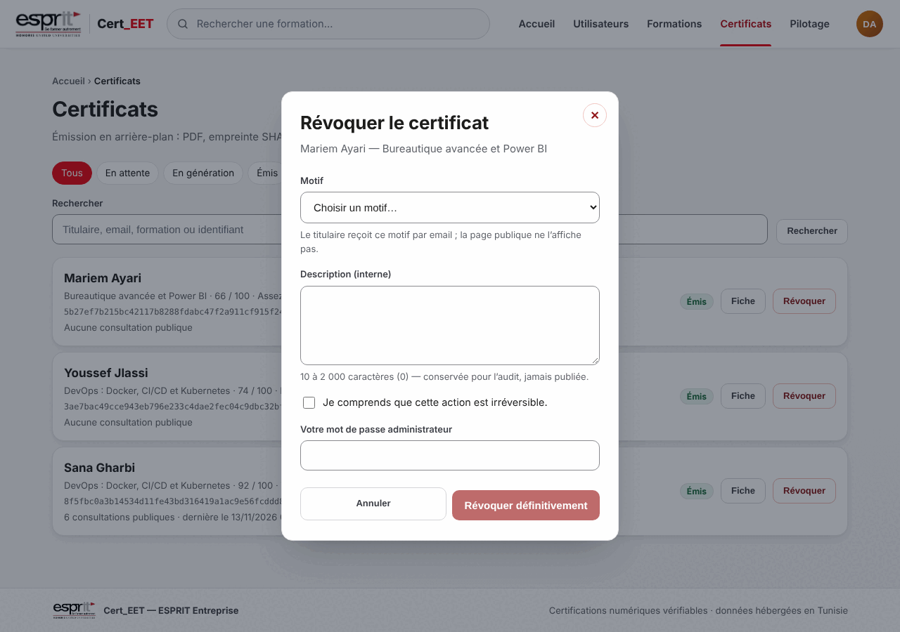

## 6. Règles par rôle

- **Apprenant** : l'action suivante est toujours visible (« Continuer », « Déposer »,
  « Retenter », « Voir le corrigé ») ; un QCM réussi ne pousse pas à repasser l'épreuve.
- **Formateur** : l'éditeur de QCM n'a qu'une action pleine, l'étape suivante (ajouter des
  questions, configurer, publier) ; l'import depuis un fichier (US-IA-08) passe toujours par
  une relecture.
- **Administrateur** : une action irréversible demande une confirmation explicite et le mot de
  passe (révoquer : motif + case « Je comprends » ; anonymiser : mot à recopier) ; le bouton de
  confirmation est `btn-danger-solid`, désactivé tant que la confirmation n'est pas complète.
- **Visiteur et recruteur** : la vérification d'un certificat se lit sans compte, avec un
  verdict en tête (« Certificat valide et authentique ») et une suite si le lien est faux.

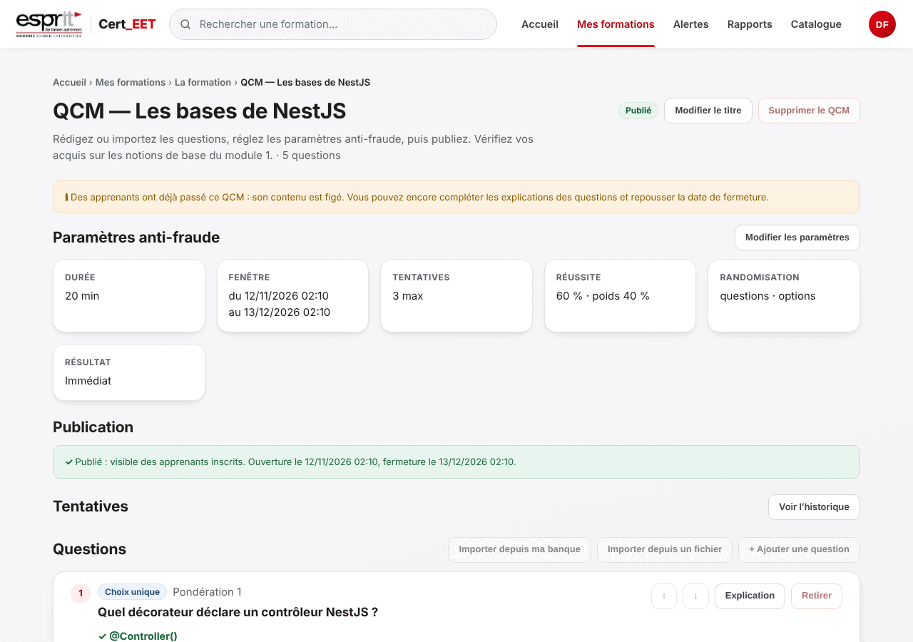

## 7. À faire / à éviter

| À faire | À éviter |
|---|---|
| Un titre, une phrase, une action pleine | Deux boutons rouges côte à côte |
| Libellés du menu repris dans les titres | Synonymes (« Tentatives » ici, « Évaluations » là) |
| État vide qui dit quoi faire | « Aucune donnée » |
| Fil d'Ariane | Lien « ← Retour » |
| Fenêtre `Fenetre` ou `CroixFermeture` | Dialogue qui ne se ferme que par un bouton |
| Couleur + icône + texte pour un état | Rouge ESPRIT pour une erreur |
| Liste compacte + fiche en fenêtre | Pile de longues cartes |

## 8. Contrôle avant fusion

1. Captures 1280 et 390 px de chaque page touchée, regardées une à une.
2. Recette de navigation (`outils/recette`, voir son README) : **0 problème**, contrastes
   compris (type `CONTRASTE_INSUFFISANT`, depuis US-UI-08).
3. `tsc`, `next lint --max-warnings 0`, `next build` ; tests unitaires et e2e de l'API verts.

## 9. Captures de référence

| Écran | Fichier |
|---|---|
| Accueil visiteur |  |
| Connexion | 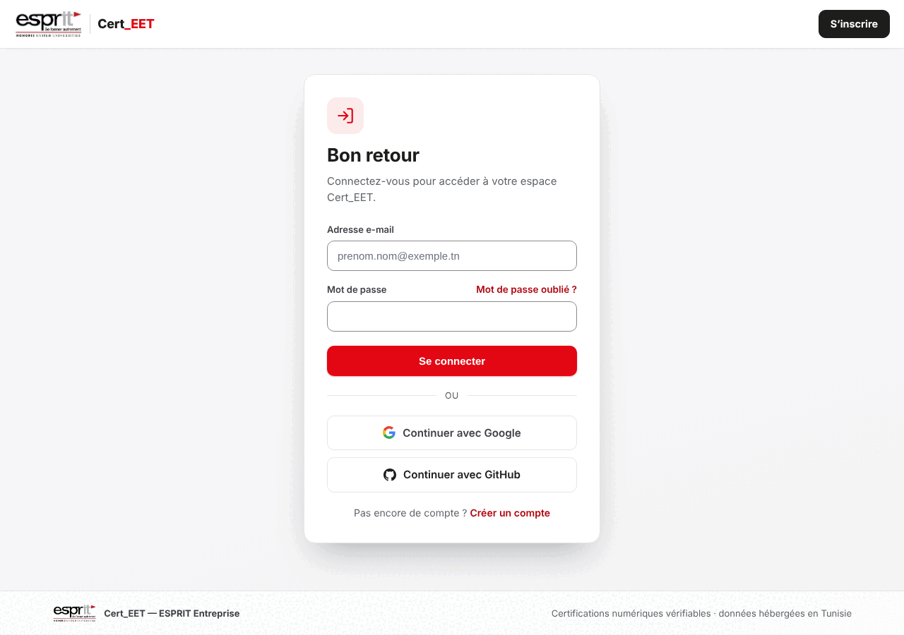 |
| Vérification publique | 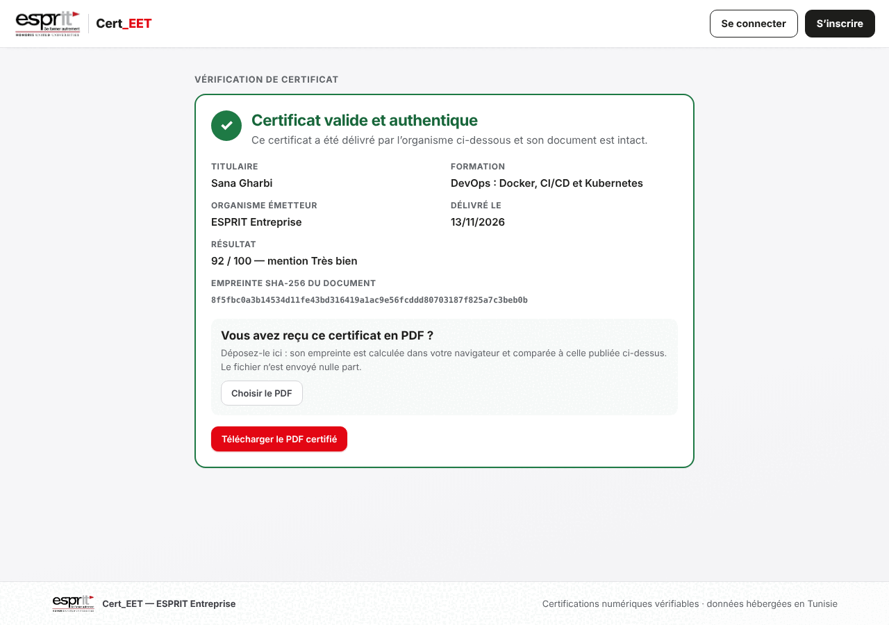 |
| Accueil apprenant (mobile) | 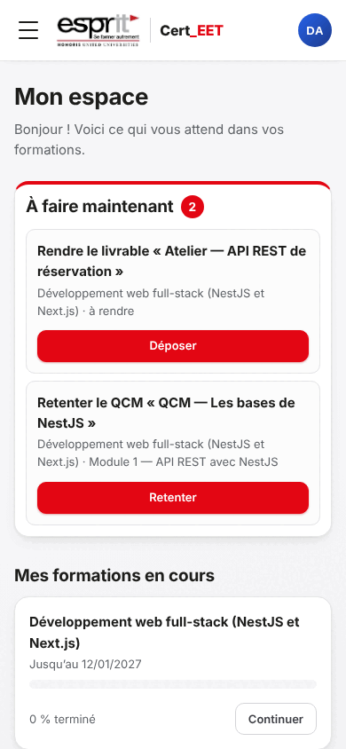 |
| Mes certificats | 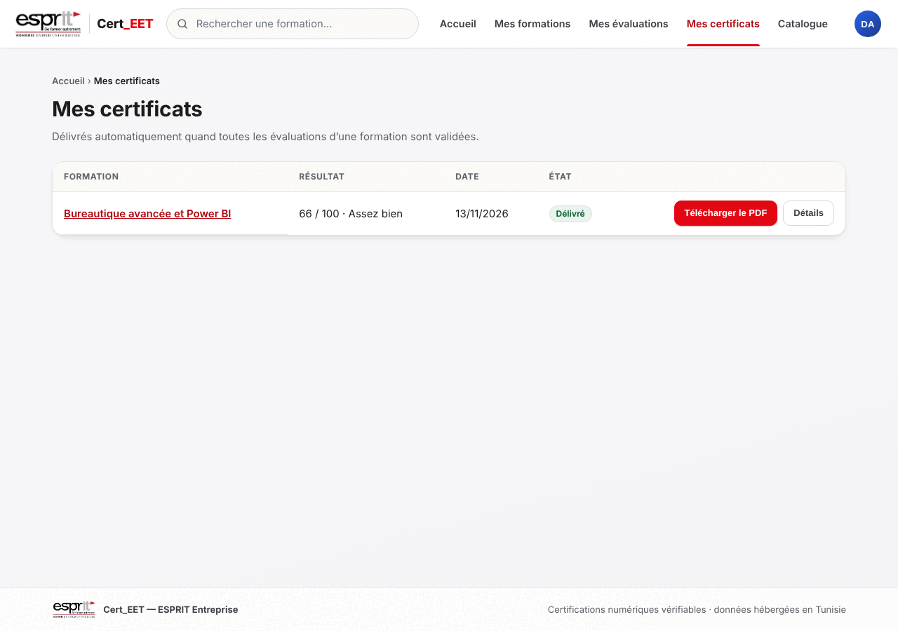 |
| Accueil formateur | 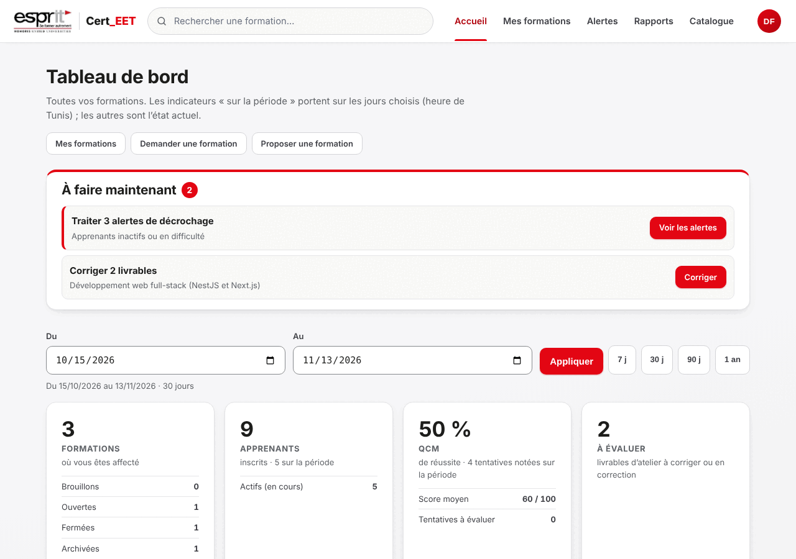 |
| Comptes (administrateur) | 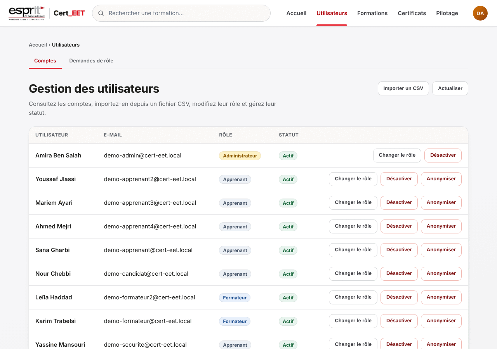 |
| Certificats (administrateur) | 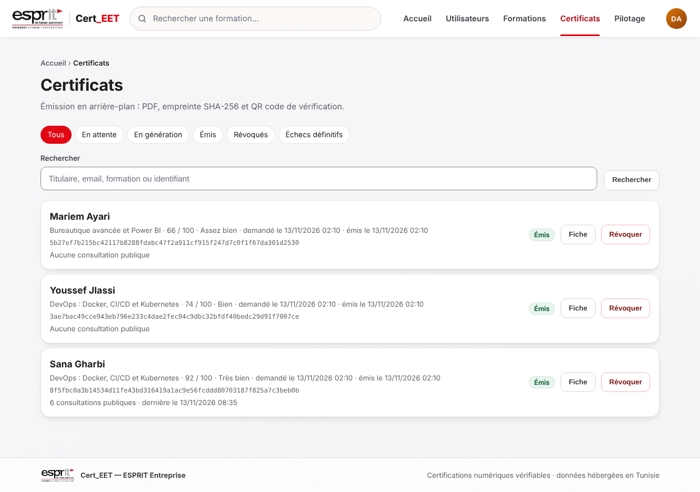 |
