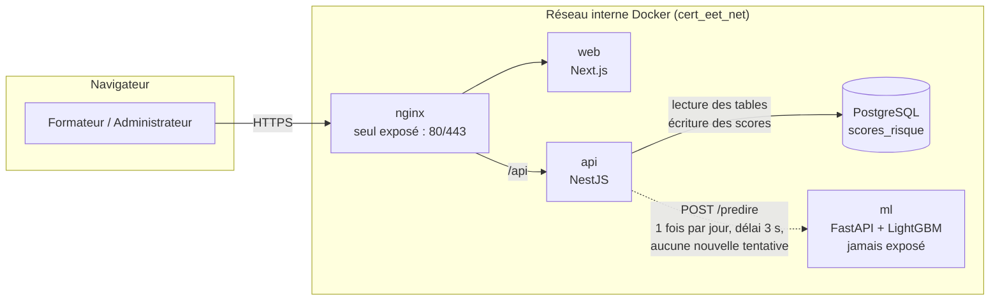

# IA — Prédiction des apprenants à risque

> Cert_EET suggère au formateur les apprenants qui risquent d'échouer ou d'abandonner, avec un
> niveau (faible / moyen / élevé) et trois raisons en français. **Le modèle suggère, le formateur
> décide.** Il complète les quatre règles d'alerte existantes, sans les remplacer ; si le service
> de prédiction est arrêté, l'application fonctionne exactement comme avant.

Détails techniques : `ml/FICHE_MODELE.md` (fiche du modèle), `ml/AUDIT_DONNEES.md` (audit des
données), `engineering-log/92-IA-prediction-risque.md` (journal et décisions).

---

## 1. Démarche

| Étape | Ce qui a été fait | Où |
|---|---|---|
| 1. Audit | Ce que Cert_EET enregistre vraiment par apprenant, et sa correspondance avec un jeu public. Seuls les signaux présents **des deux côtés** sont gardés. | `ml/AUDIT_DONNEES.md` |
| 2. Données | OULAD (32 593 inscriptions, Open University, CC BY 4.0). Étiquette « à risque » = *Fail* ou *Withdrawn*. | notebook 01 |
| 3. Variables | 16 variables calculées à une **date de coupure** (J+14 à J+56) avec uniquement le passé ; absence de fuite **testée**. | `ml/risque/variables.py`, notebook 02 |
| 4. Modèles | Règles actuelles (référence), régression logistique, LightGBM (retenu). Découpage chronologique, validation croisée groupée par session. | notebook 03 |
| 5. Seuil | 0,355, choisi sur l'entraînement pour viser 80 % de rappel. | `ml/modeles/risque_v1.json` |
| 6. Explicabilité | SHAP natif de LightGBM ; 3 raisons en français. | `ml/risque/explications.py`, notebook 04 |
| 7. Équité | Rappel, précision, ROC-AUC par genre, âge, handicap (jamais utilisés comme entrées). | notebook 04 |
| 8. Service | Conteneur `ml` (FastAPI) : `GET /sante`, `POST /predire`. | `ml/service/` |
| 9. Intégration | L'API calcule les 16 variables depuis les vraies tables, appelle le service chaque jour, enregistre les scores. | `apps/api/src/modules/prediction-risque/` |
| 10. Interface | Tableau de bord formateur (ses formations) et panneau administrateur (toutes). | `apps/web/src/components/PredictionRisque.tsx` |

## 2. Architecture

- **Calcul périodique** (jamais pendant une requête) : un minuteur de l'API, même mécanisme que
  le balayage des alertes. Premier calcul une minute après le démarrage, puis toutes les 24 h
  (`RISQUE_INTERVALLE_MINUTES`). Désactivable (`RISQUE_BALAYAGE_ACTIF=false`), désactivé en test.
- **Pour chaque inscription en cours** d'une formation ouverte commencée : 16 variables → lot de
  200 → service `ml` → probabilité, niveau, 3 raisons → table `scores_risque` (avec les variables
  et la version du modèle, conservée 180 jours).
- **Lecture** : `GET /api/formateur/risque/formations` (résumé) et
  `GET /api/formateur/formations/:id/risque` (apprenants). Formateur : seulement les formations
  auxquelles il est affecté (sinon 403 et audit `ACCES_RESSOURCE_REFUSE`) ; administrateur :
  toutes ; apprenant : jamais.

## 3. Résultats

Test sur la session 2014J, jamais vue à l'entraînement (40,2 % d'apprenants à risque). Source :
`ml/modeles/risque_v1.json` (LightGBM) et notebook 03 (règles, régression logistique).

### Rappel (part des apprenants à risque repérés)
| Date de coupure | Règles Cert_EET | Régression logistique | **LightGBM (retenu)** |
|---|---|---|---|
| J+14 | 0,28 | 0,87 | **0,87** |
| J+28 | 0,39 | 0,75 | **0,76** |
| J+42 | 0,51 | 0,70 | **0,73** |
| J+56 | 0,58 | 0,73 | **0,79** |

### Précision (part des alertes justifiées)
| Date | Règles | Régression logistique | **LightGBM** |
|---|---|---|---|
| J+14 | 0,61 | 0,47 | **0,48** |
| J+28 | 0,63 | 0,54 | **0,54** |
| J+42 | 0,62 | 0,58 | **0,57** |
| J+56 | 0,63 | 0,59 | **0,56** |

### PR-AUC et ROC-AUC (qualité du classement, indépendante du seuil)
| Date | PR-AUC règles | PR-AUC LightGBM | ROC-AUC règles | ROC-AUC LightGBM |
|---|---|---|---|---|
| J+14 | 0,47 | **0,54** | 0,58 | **0,66** |
| J+28 | 0,53 | **0,58** | 0,63 | **0,72** |
| J+42 | 0,56 | **0,61** | 0,67 | **0,74** |
| J+56 | 0,59 | **0,70** | 0,70 | **0,78** |

**À retenir :** le modèle repère **2 à 3 fois plus** d'apprenants à risque que les règles, surtout
tôt (J+14 : 87 % contre 28 %), au prix d'environ **une fausse alerte sur deux**. C'est acceptable
parce qu'une alerte n'est qu'une suggestion vérifiée par le formateur, et qu'un apprenant manqué
coûte plus cher qu'un message de trop.

Équité (rappel) : écart de 1,4 point entre genres, 4,3 entre tranches d'âge, 0,3 selon le
handicap. Précision : 0,47 pour les femmes contre 0,59 pour les hommes (voir Q6).

## 4. Garanties pour l'application existante

- Les règles d'alerte (`alertes.regles.ts`, balayage, `CritereAlerte`) ne sont **pas modifiées** ;
  les alertes s'affichent à côté de la prédiction.
- Service `ml` arrêté, lent ou en erreur : le client répond `null` après 3 s au plus, journalise un
  avertissement, n'écrit rien ; l'écran affiche « Prédiction indisponible ». Vérifié par des tests
  unitaires (faux serveur : erreur 500, JSON invalide, délai dépassé, connexion refusée) et e2e
  (service injoignable → aucune erreur, alertes des règles toujours créées).
- L'API **démarre sans** `ml` (aucun `depends_on`) ; `ml` n'a aucun port publié.
- Les 16 variables de l'API suivent exactement les définitions Python : contrôle de parité sur
  1 443 cas synthétiques, **0 écart**.

---

## 5. Questions probables du jury

**Q1. Comment évitez-vous la fuite de données (*data leakage*) ?**
À chaque date de coupure J, les variables n'utilisent que ce qui s'est passé **avant** le jour J :
activité, remises, notes connues. Une échéance future ne compte ni comme rendue ni comme non
rendue. Les examens finaux et la date de désinscription (qui est l'issue elle-même) sont exclus.
C'est **testé** : je recalcule les variables sur une copie où tout le futur est effacé, et elles
doivent être identiques aux 4 dates (notebook 02, `ml/tests/test_variables_anti_fuite.py`). Le
découpage est chronologique (test sur une session postérieure). Dans l'API, une note est datée du
moment où elle est **connue** (fin de correction), pas de la remise.

**Q2. Les classes sont-elles déséquilibrées ? Qu'avez-vous fait ?**
Peu : 52,8 % d'apprenants à risque dans OULAD (Fail + Withdrawn), 40,2 % sur la session de test.
Je n'ai donc ni suréchantillonné ni pondéré les classes. Le vrai enjeu est l'**asymétrie des
coûts** (manquer un apprenant coûte plus qu'une fausse alerte) : je le traite par le **seuil**, et
par des métriques qui ne sont pas trompées par la proportion (PR-AUC, rappel).

**Q3. Pourquoi ces métriques ?**
- **Rappel** : l'objectif métier est de ne pas manquer un apprenant qui décroche.
- **Précision** : pour mesurer la charge de fausses alertes du formateur.
- **PR-AUC** pour choisir le modèle (validation croisée) : elle juge le classement de la classe
  « à risque » sans dépendre d'un seuil, et elle est plus exigeante que la ROC-AUC.
- **ROC-AUC** et score de Brier (0,215) pour comparer avec la littérature et vérifier la
  calibration. Pas d'exactitude (*accuracy*) : trompeuse dès que les coûts diffèrent.

**Q4. Comment avez-vous choisi le seuil de 0,355 ?**
Sur l'**entraînement uniquement** (prédictions de validation croisée) : c'est le seuil le plus
haut qui atteint 80 % de rappel. Il n'a jamais été ajusté sur le test. Sur le test, le rappel
reste entre 73 % et 87 % ; il est sous 80 % à J+28 et J+42 parce que la session de test compte
moins d'apprenants à risque (40,2 % contre 45,4 %). Affichage : « faible » sous 0,355, « moyen »
au-dessus, « élevé » à partir de 0,60 (là où la calibration montre un risque réel élevé). Je
montre des **niveaux** et pas des pourcentages, car la calibration n'est fiable que jusqu'à 0,65.

**Q5. Qu'est-ce que SHAP et comment l'utilisez-vous ?**
SHAP répartit la prédiction entre les variables : valeur de base + somme des contributions = score
du modèle (exact, vérifié par un test). J'utilise le calcul **natif** de LightGBM (TreeSHAP,
`pred_contrib=True`), sans dépendance supplémentaire. Les 3 contributions positives les plus fortes
deviennent 3 phrases simples (« Aucune activité depuis 15 jours »). Les variables de calendrier
(date de coupure, nombre d'échéances) ne sont jamais présentées : elles ne décrivent pas
l'apprenant.

**Q6. Le modèle est-il équitable ?**
Le genre, l'âge, le handicap, la région et le niveau social ne sont **pas des entrées** ; ils
servent seulement à l'audit. Le rappel est quasi identique dans tous les groupes (écarts de 0,3 à
4,3 points). **Limite constatée** : pour les femmes, la précision est plus faible (0,47 contre
0,59) et la ROC-AUC aussi (0,67 contre 0,77) : elles reçoivent plus de fausses alertes. Je ne l'ai
pas corrigée par un seuil par genre, car il faudrait alors **utiliser** le genre, et Cert_EET ne le
collecte pas. Ce qui limite l'impact : une fausse alerte n'entraîne qu'une prise de contact, et
c'est le formateur qui décide. L'écart sera remesuré au réentraînement.

**Q7. OULAD ne ressemble pas à Cert_EET. Le modèle est-il valable ici ?**
C'est le principal risque (**décalage de domaine**) : enseignement à distance au Royaume-Uni,
sessions de 9 mois, 2013–2014, contre formation continue en Tunisie, plus courte. Ce que j'ai fait :
(1) n'utiliser que des signaux **transposables** (jours actifs et pas clics, remises, notes) ;
(2) mêmes définitions des deux côtés, vérifiées par un test de parité ; (3) afficher des niveaux
et une suggestion, jamais une décision ; (4) prévoir le **réentraînement** sur les données de
Cert_EET dès qu'assez de formations seront clôturées (plan en 5 étapes, `ml/FICHE_MODELE.md` §11),
avec le même code. Les performances OULAD ne sont pas garanties sur Cert_EET, et c'est écrit.

**Q8. RGPD et loi tunisienne 2004-63 ?**
- **Finalité limitée** : accompagnement pédagogique ; jamais noter, sanctionner ou refuser.
- **Minimisation** : 16 indicateurs d'activité et de résultats ; aucune donnée sensible ni
  identifiante en entrée ; le service `ml` ne reçoit qu'un identifiant d'inscription.
- **Intervention humaine** : le formateur valide toujours (aucune décision automatisée produisant
  des effets juridiques, art. 22 du RGPD).
- **Accès restreint** : formateur affecté et administrateur ; apprenant jamais ; refus audités.
- **Durée de conservation** : scores purgés après 180 jours ; supprimés avec l'inscription.
- **Transparence** : 3 raisons par score, variables et version du modèle enregistrées ;
  information des apprenants à prévoir dans la politique de confidentialité.
- **Souveraineté** : modèle et données hébergés localement, aucun service externe.
La loi organique n° 2004-63 impose les mêmes principes (consentement ou intérêt légitime,
finalité, proportionnalité, sécurité) ; une déclaration auprès de l'INPDP est à prévoir avant la
mise en production.

**Q9. Pourquoi un conteneur séparé plutôt que le modèle dans l'API ?**
- **Isolation des pannes** : un crash ou une lenteur du modèle ne touche pas l'API.
- **Bon outil** : le modèle est en Python (scikit-learn, LightGBM) ; le réécrire en JavaScript
  serait risqué. Les versions exactes de l'entraînement sont figées dans l'image.
- **Sécurité** : réseau interne, aucun port publié, utilisateur non root, système de fichiers en
  lecture seule, image sans données.
- **Évolution** : nouveau modèle = nouvelle image, sans redéployer l'API ; testé à part (job CI).

**Q10. Que se passe-t-il si le service tombe ? (repli silencieux)**
Rien de visible pour l'apprenant, et rien de cassé pour personne : le client attend 3 s au plus,
**sans nouvelle tentative**, journalise un avertissement et n'écrit aucun score. Les quatre règles
continuent à créer leurs alertes. Côté formateur, un score de plus de 26 h n'est plus montré :
l'écran indique « Prédiction indisponible » et garde les alertes des règles. C'est couvert par des
tests e2e.

**Q11. Pourquoi LightGBM et pas un réseau de neurones ?**
Données tabulaires de taille moyenne : les arbres boostés sont l'état de l'art, rapides, et
compatibles avec un SHAP exact. LightGBM ne bat la régression logistique que de peu (PR-AUC 0,740
contre 0,731) ; il est retenu pour ce léger gain et parce qu'il gère nativement les valeurs vides
(pas encore de note).

**Q12. Le modèle peut-il se tromper sur quelqu'un ?**
Oui, environ une alerte sur deux est fausse. C'est pourquoi l'interface dit toujours « Suggestion du
modèle, à valider par le formateur », montre les raisons pour qu'il puisse les vérifier, et affiche
les alertes factuelles des règles à côté.
